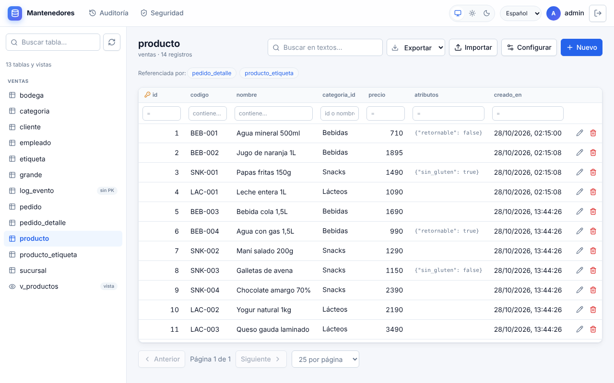
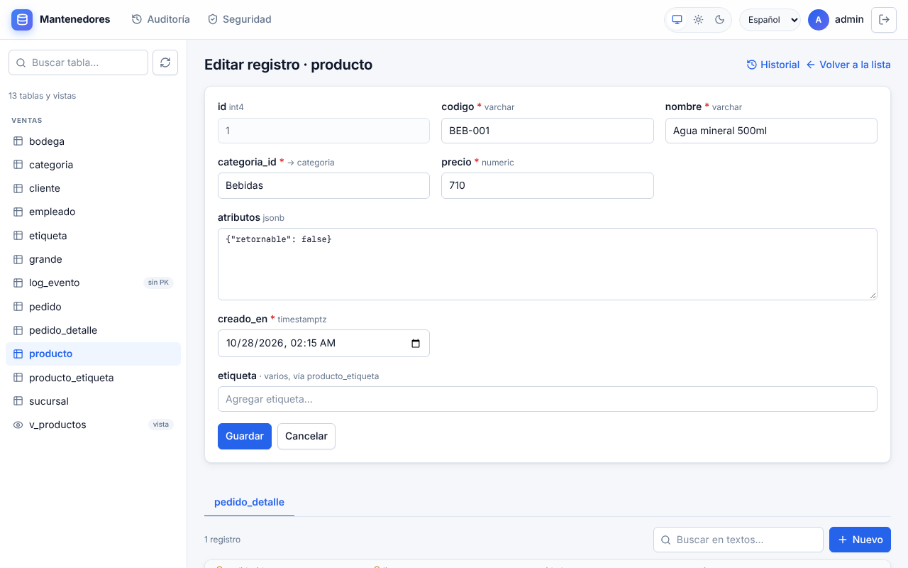
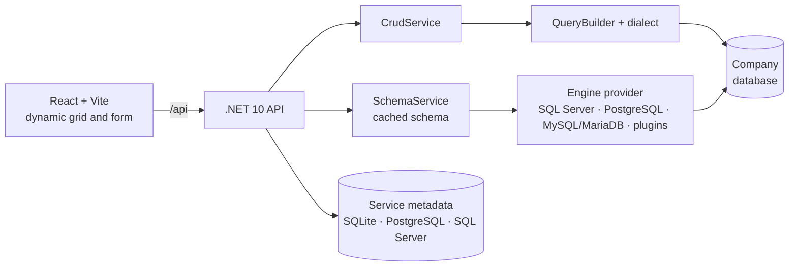

<div align="center">

# Dynamic maintainers

**Connect a database and instantly get a CRUD screen for every table.**
No screens or queries to write: the app reads the schema and builds the list, filters, form and permissions.

[](https://github.com/Ashuraxaxa/CodeAndForget/actions/workflows/ci.yml)


[Español](README.md) · **English**

<picture>
  <source media="(prefers-color-scheme: dark)" srcset="docs/img/mantenedor-oscuro.png">
  
</picture>

</div>

> The detailed documentation in `docs/` is in Spanish. The interface is available in Spanish, English and Russian.

## What it does

1. **Connect** to a SQL Server, PostgreSQL, MySQL or MariaDB database.
2. **The app reads the catalog:** tables, views, columns, types, primary, unique and foreign keys.
3. **Every table gets its maintainer:** a list with sorting, filters and search; create, edit and delete; searchable
   dropdowns for foreign keys.

Everything else is adjusted from the interface, without code changes or restarts.

## Features

| | |
|---|---|
| 🧩 **Generated maintainers** | Grid, form and validation from the schema. Composite keys, views and tables without a key (read-only), identity and computed columns. |
| 🔗 **Relations** | Searchable foreign-key dropdowns (multi-column keys too), master-detail tabs, many-to-many pickers and drag-and-drop trees for self-referencing tables. |
| ⚙️ **No-code settings** | Display names per language, hidden or required columns, ordering, widgets, virtual primary and foreign keys, and buttons that call stored procedures. |
| 🗂️ **Special types** | JSON, enums, arrays, files with image previews, geographic data as WKT (PostGIS included) and numbers with more than 28 digits. |
| 📤 **Export and import** | CSV, Excel, JSON and XML of the filtered list; imports with a preview, per-row errors and update by key. |
| 🔐 **Security** | Local login or any OIDC provider (Keycloak, Duende, Entra ID…). Profiles with permissions per connection, table, column and action. |
| 🤖 **AI through MCP** | Built-in suggestions and an optional MCP server: Claude, Cursor or another AI reviews the schema and proposes settings that a person accepts. The token has the access of whoever creates it. |
| 🕵️ **Audit** | Who changed what and when, with per-record history and export. Concurrent edits never overwrite each other silently. |
| 🌐 **Languages and theme** | Spanish, English and Russian, with dates and numbers in each one's format. Light, dark or system theme. |
| 🚀 **Production ready** | Health checks, OpenTelemetry, rate limits, tables with millions of rows, several instances (optional Redis) and extra engines as plugins. |

<details>
<summary>More screenshots: form with master-detail</summary>

<picture>
  <source media="(prefers-color-scheme: dark)" srcset="docs/img/formulario-oscuro.png">
  
</picture>

</details>

## Quick start

With Docker, the app plus three sample databases:

```bash
docker compose up --build
```

Open <http://localhost:8080>, sign in with `admin` / `admin` (demo only) and create a connection:

| Engine | Connection string |
|---|---|
| PostgreSQL | `Host=pg-demo;Port=5432;Database=demo;Username=postgres;Password=postgres` |
| SQL Server | `Server=mssql-demo,1433;Database=Demo;User Id=sa;Password=Demo_Pass_123!;TrustServerCertificate=True` |
| MySQL | `Server=mysql-demo;Port=3306;Database=ventas;User ID=root;Password=demo` |

For a real installation (Docker, Kubernetes, IIS, Windows service or systemd): [docs/despliegue.md](docs/despliegue.md).

## Installation requirements

> **Check this section before installing or connecting a new database.**
> The minimum versions are a project decision (D-035): below them the service is not tested and the connection
> is not supported.

| Engine | Minimum version | Tested in CI | How to check the version |
|---|---|---|---|
| SQL Server | **2016** (13.x) | 2017 and 2022 | `SELECT SERVERPROPERTY('ProductVersion');` |
| PostgreSQL | **12** | 12 and 16 (also with PostGIS) | `SHOW server_version;` |
| MySQL | **8.0** | 8.0 and 8.4 | `SELECT VERSION();` |
| MariaDB | **10.6** | 10.6 and 11.4 | `SELECT VERSION();` (the text includes `MariaDB`) |

- SQL Server 2016 has no container image: compatibility is kept by not using T-SQL newer than 2016.
- Oracle is not supported (D-034). Other engines can be added as plugins ([motores.md](docs/motores.md#motores-como-plugins)).
- The **connection test** shows the server product and version, and rejects servers below the minimum.
  There is no compatibility mode for versions the vendor no longer supports.

**Database user:** a dedicated one for the service, never `sa`, `postgres` or `root`, with catalog read access and
`SELECT`, `INSERT`, `UPDATE` and `DELETE` on the schemas to expose. If the database denies a permission, the app says
so and what to ask the DBA for.

**To run the service:** Docker 20+, or the ASP.NET Core 10 runtime without Docker.

## How it works



- **Safe SQL:** table and column names only come from the catalog that was read, always quoted; values are always parameters.
- **Engine differences** live only in each provider; all of them pass the same test suite against real databases.
- **Everything by configuration:** every piece has a default that works without external services (no cloud, no
  Redis, no mandatory identity provider).

## Configuration

The most common keys (as environment variables):

| Key | Purpose |
|---|---|
| `Auth__Mode` | `Local` (users in configuration, the default) or `Jwt` (any OIDC issuer). |
| `Auth__JwtKey` | Key that signs `Local` mode tokens (at least 32 characters). |
| `Metadata__Provider` | Where the app keeps its connections and settings: `Sqlite` (default), `Postgres` or `SqlServer`. |
| `Hosting__PathBase` | Sub-path to publish under, e.g. `/mantenedores`. |
| `Cache__Provider` | `Memory` (default) or `Redis`, for several instances. |

Every key and its default value: [docs/configuracion.md](docs/configuracion.md).

> The data folder (`Storage__DataDirectory`) holds the keys that decrypt the connection strings: back it up and
> protect it.

## Development

Requirements: .NET 10 SDK, Node 20+ and Docker (for the integration tests).

```bash
cd backend && dotnet run --project src/Mantenedores.Api   # API on :5080 (admin / admin in Development)
cd frontend && npm install && npm run dev                 # UI on :5173 (proxies /api to the API)
```

Tests and checks:

```bash
cd backend && dotnet test tests/Mantenedores.Tests              # unit tests
cd backend && dotnet test tests/Mantenedores.IntegrationTests   # all four engines in containers
cd frontend && npm run lint && npm run build                    # includes the translation check
```

The integration tests use the minimum versions; for another one, `MANTENEDORES_PG_IMAGE=postgres:16` and similar.

## Documentation (Spanish)

| Document | Contents |
|---|---|
| [configuracion.md](docs/configuracion.md) | Every configuration key |
| [despliegue.md](docs/despliegue.md) | Docker, Kubernetes, nginx, IIS, Windows service, systemd |
| [ajustes.md](docs/ajustes.md) | Per-table and per-column settings |
| [seguridad.md](docs/seguridad.md) | Profiles, permissions and audit |
| [mcp.md](docs/mcp.md) | Connecting an AI through MCP to review the schema and propose settings |
| [comercial/](docs/comercial/plan-comercial.md) | Celdo: business plan, brand manual and landing page (`landing/`), in Spanish |
| [api.md](docs/api.md) | API routes |
| [motores.md](docs/motores.md) | Engine differences and how to add one |
| [carga.md](docs/carga.md) | Load tests and results |
| [memoria/](docs/memoria/README.md) | Project status, decisions and backlog |
