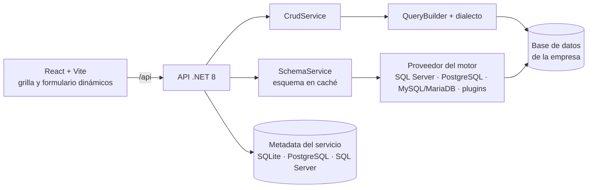

<div align="center">

# Mantenedores dinámicos

**Conecta una base de datos y obtén al instante el mantenedor de cada tabla.**
Sin escribir pantallas ni consultas: la app lee el esquema y genera listado, filtros, formulario y permisos.

[](https://github.com/Ashuraxaxa/CodeAndForget/actions/workflows/ci.yml)


**Español** · [English](README.en.md)

<picture>
  <source media="(prefers-color-scheme: dark)" srcset="docs/img/mantenedor-oscuro.png">
  
</picture>

</div>

## Qué hace

1. **Te conectas** a una base SQL Server, PostgreSQL, MySQL o MariaDB.
2. **La app lee el catálogo:** tablas, vistas, columnas, tipos, claves primarias, únicas y foráneas.
3. **Cada tabla tiene su mantenedor:** listado con orden, filtros y búsqueda; alta, edición y borrado; combos con
   búsqueda para las claves foráneas.

Todo lo demás se ajusta desde la interfaz, sin tocar código ni reiniciar.

## Funciones

| | |
|---|---|
| 🧩 **Mantenedores generados** | Grilla, formulario y validaciones a partir del esquema. PK compuestas, vistas y tablas sin PK (solo lectura), identity, columnas calculadas. |
| 🔗 **Relaciones** | Combos de FK con búsqueda (también FK de varias columnas), maestro-detalle en pestañas, N:M con selector múltiple y árboles con arrastre para tablas con autorreferencia. |
| ⚙️ **Ajustes sin código** | Nombres visibles por idioma, columnas ocultas u obligatorias, orden, controles, FK y PK virtuales, y botones que llaman a procedimientos almacenados. [ajustes.md](docs/ajustes.md) |
| 🗂️ **Tipos especiales** | JSON, enums, arreglos, archivos con vista previa de imágenes, datos geográficos en WKT (PostGIS incluido) y números de más de 28 dígitos. |
| 📤 **Exportar e importar** | CSV, Excel, JSON y XML del listado filtrado; importación con vista previa, errores por fila y actualización por clave. |
| 🔐 **Seguridad** | Login local o cualquier proveedor OIDC (Keycloak, Duende, Entra ID…). Perfiles con permisos por conexión, tabla, columna y acción. [seguridad.md](docs/seguridad.md) |
| 🕵️ **Auditoría** | Quién cambió qué y cuándo, con historial por registro y exportación. Edición simultánea sin pisar cambios ajenos. |
| 🌐 **Idiomas y tema** | Interfaz en español, inglés y ruso, con fechas y números en el formato de cada uno. Modo día, noche o el del sistema. |
| 🚀 **Listo para producción** | Health checks, OpenTelemetry, límites de uso, tablas de millones de filas, varias instancias (Redis opcional) y motores extra como plugins. |

<details>
<summary>Más capturas: formulario con maestro-detalle</summary>

<picture>
  <source media="(prefers-color-scheme: dark)" srcset="docs/img/formulario-oscuro.png">
  
</picture>

</details>

## Inicio rápido

Con Docker, la app y tres bases de ejemplo:

```bash
docker compose up --build
```

Abre <http://localhost:8080>, entra con `admin` / `admin` (solo de demo) y crea una conexión:

| Motor | Cadena de conexión |
|---|---|
| PostgreSQL | `Host=pg-demo;Port=5432;Database=demo;Username=postgres;Password=postgres` |
| SQL Server | `Server=mssql-demo,1433;Database=Demo;User Id=sa;Password=Demo_Pass_123!;TrustServerCertificate=True` |
| MySQL | `Server=mysql-demo;Port=3306;Database=ventas;User ID=root;Password=demo` |

Para instalarla en serio (Docker, Kubernetes, IIS, servicio de Windows o systemd): [docs/despliegue.md](docs/despliegue.md).

## Requisitos de instalación

> **Antes de instalar o de conectar una base nueva, verifica esta sección.**
> Las versiones mínimas son una decisión del proyecto (D-035): por debajo de ellas el servicio
> no se prueba y la conexión no está soportada.

| Motor | Versión mínima | Probado en la CI | Cómo ver la versión |
|---|---|---|---|
| SQL Server | **2016** (13.x) | 2017 y 2022 | `SELECT SERVERPROPERTY('ProductVersion');` |
| PostgreSQL | **12** | 12 y 16 (también con PostGIS) | `SHOW server_version;` |
| MySQL | **8.0** | 8.0 y 8.4 | `SELECT VERSION();` |
| MariaDB | **10.6** | 10.6 y 11.4 | `SELECT VERSION();` (el texto incluye `MariaDB`) |

- SQL Server 2016 no tiene imagen para contenedores: su compatibilidad se cuida no usando T-SQL posterior a 2016.
- Oracle no está soportado (D-034). Otros motores pueden agregarse como plugin ([motores.md](docs/motores.md#motores-como-plugins)).
- La **prueba de conexión** muestra el producto y la versión del servidor, y rechaza los que están por debajo del mínimo.
  No hay modo de compatibilidad para versiones sin soporte del fabricante.

**Usuario de la base:** uno dedicado para el servicio, nunca `sa`, `postgres` ni `root`, con lectura del catálogo y
`SELECT`, `INSERT`, `UPDATE` y `DELETE` sobre los esquemas a exponer. Si a la base le falta un permiso, la app lo
dice y explica qué pedirle al DBA.

**Para ejecutar el servicio:** Docker 20+, o el runtime de ASP.NET Core 8 sin Docker.

## Cómo funciona



- **SQL seguro:** tablas y columnas solo desde el catálogo leído, siempre delimitadas; los valores, siempre como parámetros.
- **Las diferencias entre motores** viven solo en cada proveedor; todos pasan la misma batería de pruebas contra bases reales.
- **Todo por configuración:** cada pieza tiene un valor por defecto que funciona sin servicios externos (sin nube, sin
  Redis, sin proveedor de identidad obligatorio).

## Configuración

Lo más usado (como variables de entorno):

| Clave | Para qué |
|---|---|
| `Auth__Mode` | `Local` (usuarios en la configuración, por defecto) o `Jwt` (cualquier emisor OIDC). |
| `Auth__JwtKey` | Clave para firmar los tokens del modo `Local` (mín. 32 caracteres). |
| `Metadata__Provider` | Dónde guarda la app sus conexiones y ajustes: `Sqlite` (por defecto), `Postgres` o `SqlServer`. |
| `Hosting__PathBase` | Subruta de publicación, p. ej. `/mantenedores`. |
| `Cache__Provider` | `Memory` (por defecto) o `Redis`, para varias instancias. |

Todas las claves y sus valores por defecto: [docs/configuracion.md](docs/configuracion.md).

> La carpeta de datos (`Storage__DataDirectory`) guarda las llaves que descifran las cadenas de conexión:
> respáldala y protégela.

## Desarrollo

Requisitos: .NET 8 SDK, Node 20+ y Docker (para las pruebas de integración).

```bash
cd backend && dotnet run --project src/Mantenedores.Api   # API en :5080 (admin / admin en Development)
cd frontend && npm install && npm run dev                 # UI en :5173 (redirige /api a la API)
```

Pruebas y chequeos:

```bash
cd backend && dotnet test tests/Mantenedores.Tests              # unitarias
cd backend && dotnet test tests/Mantenedores.IntegrationTests   # los cuatro motores en contenedores
cd frontend && npm run lint && npm run build                    # incluye el chequeo de traducciones
```

Las pruebas de integración usan las versiones mínimas; para otra, `MANTENEDORES_PG_IMAGE=postgres:16` y similares
([configuracion.md](docs/configuracion.md#pruebas-de-integración)).

<details>
<summary>Estructura del repositorio</summary>

```
backend/
  src/Mantenedores.Core                  Modelo de esquema, QueryBuilder y servicios (sin dependencia de motor)
  src/Mantenedores.Providers.SqlServer   Catálogo y dialecto de SQL Server
  src/Mantenedores.Providers.Postgres    Catálogo y dialecto de PostgreSQL
  src/Mantenedores.Providers.MySql       Catálogo y dialecto de MySQL / MariaDB
  src/Mantenedores.Metadata              Metadata del servicio y sus migraciones
  src/Mantenedores.Api                   API, autenticación e infraestructura
  tests/                                 Unitarias, integración (Testcontainers) y plugin de prueba
frontend/                                React + Vite + TanStack Query
samples/                                 Bases de ejemplo por motor, Keycloak y Duende de prueba
tests/load/                              Prueba de carga con k6
docs/                                    Documentación y memoria del proyecto
```

</details>

## Documentación

| Documento | Contenido |
|---|---|
| [configuracion.md](docs/configuracion.md) | Todas las claves de configuración |
| [despliegue.md](docs/despliegue.md) | Docker, Kubernetes, nginx, IIS, servicio de Windows, systemd |
| [ajustes.md](docs/ajustes.md) | Qué se puede ajustar por tabla y columna |
| [seguridad.md](docs/seguridad.md) | Perfiles, permisos y auditoría |
| [api.md](docs/api.md) | Rutas de la API |
| [motores.md](docs/motores.md) | Diferencias entre motores y cómo agregar uno |
| [carga.md](docs/carga.md) | Pruebas de carga y resultados |
| [memoria/](docs/memoria/README.md) | Estado, decisiones y pendientes del proyecto |
